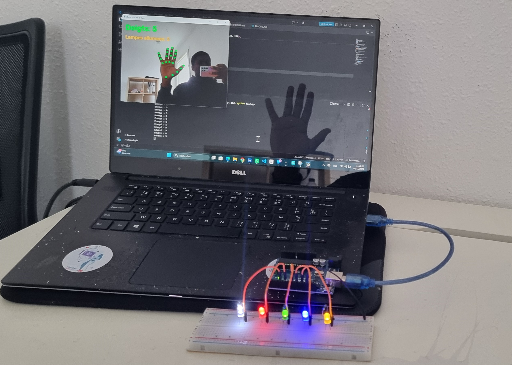
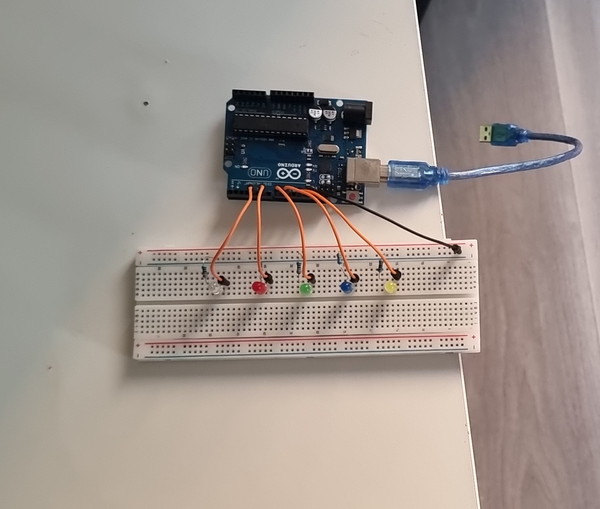

# Contrôle d'LED par comptage de doigts (vision par ordinateur + Arduino)

Une webcam filme la main, un script Python compte les doigts levés et
envoie ce nombre à une carte Arduino Uno, qui allume autant de LED.

> Projet inspiré d'une démonstration vue sur LinkedIn, que j'ai
> réimplémentée de zéro pour comprendre chaque brique.



## Principe

| Bloc | Rôle |
|---|---|
| PC (Python) | Capture vidéo (OpenCV), détection de 21 points de la main (MediaPipe), comptage des doigts |
| Liaison série USB | Transmission du nombre (un caractère `0` à `5`) à 9600 bauds |
| Arduino Uno | Lecture du caractère et commande des 5 LED |

Un filtre de stabilité (5 images identiques consécutives) évite le
clignotement dû aux erreurs de détection ponctuelles.

## Comportement

| Doigts levés | Résultat |
|---|---|
| 0 (ou pas de main) | Toutes les LED éteintes |
| 1 à 4 | Autant de LED allumées, **de la droite vers la gauche** |
| 5 | Toutes les LED **clignotent**  |

Le clignotement s'arrête dès que la main change de position.
## Matériel
- Arduino Uno
- 5 LED + 5 résistances de 330 Ω
- Breadboard et fils
- Webcam (celle du PC)

## Câblage
Les LED sont branchées sur les broches 12, 10, 8, 6 et 4 (dans cet ordre,
de droite à gauche sur mon montage). Chaque LED : broche → patte longue (+),
patte courte (−) → résistance 330 Ω → GND.




## Installation
1. Installer Python 3.11
2. Créer et activer l'environnement virtuel :
   ```
   python -m venv venv
   venv\Scripts\activate
   ```
3. Installer les dépendances : `pip install -r requirements.txt`
4. Télécharger le modèle MediaPipe dans le dossier du projet :
   ```
   Invoke-WebRequest -Uri "https://storage.googleapis.com/mediapipe-models/hand_landmarker/hand_landmarker/float16/1/hand_landmarker.task" -OutFile hand_landmarker.task
   ```
5. Téléverser `arduino/doigts_led/doigts_led.ino` sur la carte avec l'Arduino IDE
6. Fermer le moniteur série, adapter `PORT` dans `main.py` si besoin
   (COM3 par défaut), puis lancer : `python main.py`

Quitter : touche Échap sur la fenêtre de la caméra.

## Difficultés rencontrées
- MediaPipe récent : l'ancienne API `solutions` n'existe plus, utilisation
  de l'API `tasks` avec un fichier modèle
- Le moniteur série ajoute une fin de ligne qui était lue comme un nombre
  négatif : le code Arduino ignore désormais tout caractère hors `0` à `5`
- L'ouverture du port série redémarre l'Arduino : pause de 2 s nécessaire
- Erreur `could not open port 'COM3'` : câble USB mal branché ou port série
  différent (commande `python -m serial.tools.list_ports` pour le retrouver),
  ou moniteur série de l'Arduino IDE resté ouvert
- Erreur `No module named 'cv2'` : environnement virtuel non activé dans le
  terminal (il faut voir `(venv)` avant de lancer le script)
- delay() bloquait la lecture de la série pendant le clignotement : remplacé par millis() pour un clignotement non bloquant
## Pistes d'amélioration
- Commande d'un servo par l'ouverture de la main
- Communication bidirectionnelle (mesures renvoyées vers le PC)
- Application à un convoyeur avec tri par vision

## Auteur
Sodik EYISSE